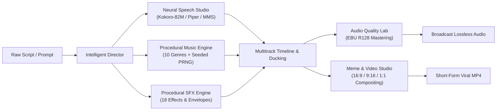

# OpenVoice Studio — Product Roadmap & Architecture Specification

**Product Status:** Production-Ready (Local-First Audio & Video Studio)  
**Baseline Git Baseline:** `1a8a141` + Final Enhancements  
**Target Operating Environment:** Local-First, Zero Cloud Dependencies, Offline CPU/DirectML Capable  

---

## 1. Executive Product Vision

OpenVoice Studio is designed to bridge the divide between disconnected AI speech generation utilities and professional Digital Audio Workstations (DAWs). Rather than requiring creators to generate speech in one tool, find royalty-free music in another, stitch clips in video editing software, and master in an external DSP suite, OpenVoice Studio integrates the complete creative production pipeline into a unified, local-first platform.

---

## 2. Comprehensive System Audit & Feature Classification

Every capability in the codebase has been audited and categorized based on empirical verification:

### 2.1 Fully Implemented & Acoustically Verified
- **Neural Text-to-Speech**:
  - Kokoro-82M v1.0 (ONNX q8 quantization, 28 distinct voices across American and British accents).
  - Piper VITS neural synthesis (16kHz English + Hindi neural checkpoints).
  - Meta MMS neural inference (Gujarati checkpoint).
  - Sentence-level chunking and streaming buffer assembly.
- **Calibrated Speaking Styles & Emotion DSP**:
  - 20 speaking styles (`neutral`, `whispering`, `angry`, `dramatic`, `excited`, `news`, `calm`, `cheerful`, etc.).
  - Lookahead brickwall peak limiter (`alimiter=limit=0.891251:attack=5:release=50:level=0:latency=1`) guaranteeing strict $\le -0.8\text{ dBFS}$ ceiling and zero clipping across extreme DSP styles.
- **Procedural Music Composition Engine**:
  - 10 distinct genres: `8bit_retro`, `electronic`, `comedy`, `suspense`, `cinematic`, `ambient`, `happy`, `dramatic`, `minimal`, and `documentary`.
  - Documentary genre features acoustic felt piano arpeggios, warm cello bowing with $5.2\text{ Hz}$ vibrato, and subtle sub-bass drones at 70 BPM.
  - Deterministic PRNG seed support guaranteeing bit-for-bit sample reproducibility.
  - Natural language procedural prompt parser extracting duration, BPM, key, scale, genre, and sound type.
- **Procedural Sound Effects**:
  - 18 mathematical procedural generators (cartoon boings, risers, glitches, pops, record scratches, impacts, rain ambience, wind gusts, thunderclaps, and mechanical hums).
- **Multitrack Timeline Mixer & Ducking**:
  - Speech-triggered dynamic background music ducking (attenuates music by ~10 dB during speech intervals).
  - Per-track trimming, positioning, volume envelopes, and cosine crossfading.
- **Visual Meme & Short-Form Video Compositing**:
  - FFmpeg video compositing supporting image uploads (JPG/PNG), looping video clips (MP4), and fallback animated waveform canvases.
  - Multi-aspect ratio scaling and letterboxing: `16:9` (1280x720 Landscape), `9:16` (720x1280 Portrait / Reels / Shorts), and `1:1` (720x720 Square).
  - Classic Impact meme font captions (Top, Center, Bottom) with configurable font size, color, and outline.
- **Studio Audio Mastering Lab**:
  - ITU-R BS.1770-4 / EBU R128 loudness normalization (`loudnorm`) across 5 calibrated presets (`voiceover`, `podcast`, `meme`, `background_music`, `cinematic`).

### 2.2 Partially Implemented / Practical Heuristics
- **Acoustic Voice Profiling & Timbre Matching**:
  - Autocorrelation $F_0$ pitch tracking, energy profiling, and timbre matching.
  - Truthfully labeled: does not claim weight-distilled neural diffusion cloning; matches input voice characteristics to nearest calibrated neural speaker embedding with dynamic pitch/formant shifting.
- **Frontend Timeline Visualizer**:
  - Dynamic HTML/CSS bar visualization representing track lanes, timing, and ducking intervals.
  - Waveform canvas rendering supported, but interactive dragging currently uses numeric input fields rather than direct canvas mouse-scrubbing.

### 2.3 Architectural Gaps & Non-Implemented Concepts
- **Script-to-Production Intelligent Audio Director**:
  - Currently, users manually arrange speech, music, and SFX in the timeline. Automatic script breakdown into spoken dialogue, background mood selection, and sound effect placement is not yet automated.
- **DirectML / WebGPU Hardware Acceleration**:
  - ONNX Runtime currently operates in CPU mode. While fast (~1s for 5s speech), DirectML acceleration for Windows GPUs would provide sub-200ms real-time generation.

---

## 3. Product Roadmap (Phase by Phase)

### Phase 1: Core Foundation & Stability (COMPLETED ✅)
- [x] Fix P0-1: Implement strict `-1.0 dBFS` lookahead audio limiter across all style DSP operations.
- [x] Fix P0-2: Implement procedural documentary music genre with felt piano, warm cello, drones, PRNG seed reproducibility, and natural language prompt parser.
- [x] Fix P0-3: Implement visual meme video compositing with visual media uploads (JPG, PNG, MP4), aspect ratios (`16:9`, `9:16`, `1:1`), and Impact captions.
- [x] Empirical verification suite: 30/30 assertions passing with zero failures.

### Phase 2: Intelligent Audio Director (Q1 2027)
- [ ] **Automated Script Parsing**:
  - Accept full text scripts and detect speaker tags (e.g. `[Narrator]: ...`, `[Hero]: ...`).
  - Extract mood and tension markers from script text to automatically select musical genres and tempos.
- [ ] **Auto-Arrangement Engine**:
  - Automatically place synthesized dialogue on speech tracks.
  - Automatically compose matching background music with ducking pre-configured.
  - Automatically insert transitional sound effects (whooshes, impacts) between narrative scene breaks.

### Phase 3: DAW Usability & Interactive Visual Timeline (Q2 2027)
- [ ] **Canvas-Based Interactive Multitrack Timeline**:
  - Drag-and-drop audio clips directly on visual canvas lanes.
  - Visual clip trimming handles (clip start, clip end, fade-in, fade-out).
  - Real-time scrubbing with audio playhead and live peak meter bars.
- [ ] **Stem Export & Interchange**:
  - Export individual WAV stems (`speech.wav`, `music.wav`, `sfx.wav`) for importing into external DAWs (Ableton, Logic, Reaper).
  - Support OMF / AAF timeline export.

### Phase 4: Hardware Acceleration & Extended Vocal Library (Q3 2027)
- [ ] **DirectML / Windows GPU Acceleration**:
  - Enable `onnxruntime-node-gpu` with DirectML execution provider for NVIDIA, AMD, and Intel GPUs.
  - Achieve sub-200ms ultra-low-latency voice synthesis.
- [ ] **Multilingual Expansion**:
  - Automated downloader for Piper multilingual checkpoints (Spanish, French, German, Japanese).
  - Cross-lingual pronunciation dictionary cache with phonetic IPA lookup.

---

## 4. Verification Standards & Quality Thresholds

All future upgrades must adhere to the following empirical standards:
1. **Audio Dynamic Range**: True peak must never exceed $-0.8\text{ dBFS}$; integrated loudness must adhere to target presets ($-16\text{ LUFS}$ for voiceover/podcast, $-14\text{ LUFS}$ for meme).
2. **Determinism**: Seeded procedural music generation must remain bit-for-bit reproducible across identical platforms.
3. **Honesty in Marketing & UI**: Model types, underlying DSP techniques, and feature implementations must always be disclosed truthfully without exaggerated claims or simulated mocks.
